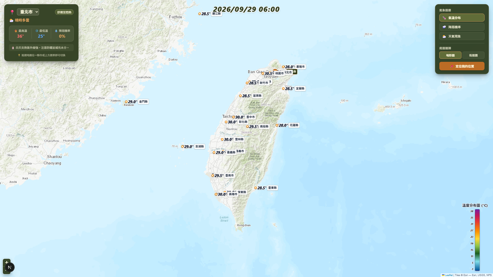

# 🌦️ Taiwan Weather GIS Dashboard

### 台灣氣象 GIS 地圖儀表板

# 🌦️ Taiwan Weather GIS Dashboard

<p align="center">
  
</p>

結合中央氣象署（CWA）公開氣象資料、SQLite 資料庫與互動式 GIS 地圖，將台灣 22 縣市的天氣預報轉化為直覺、易讀的地理視覺化資訊。

本專案以互動式地圖為核心，提供氣溫、降雨機率與天氣現象等資訊，並結合地理定位、圖層切換與動態生活建議，打造兼具實用性與視覺體驗的氣象資訊儀表板。

---

## ✨ 專案特色

- 🗺️ **互動式台灣地圖**：透過 Leaflet 呈現台灣地理資訊與 22 縣市氣象數據。
- 🌡️ **多種氣象圖層**：支援氣溫分布、降雨機率與天氣現象切換。
- 📍 **GPS 地理定位**：取得使用者授權後，定位目前位置並聚焦鄰近縣市。
- 🌧️ **即時氣象資訊卡**：集中呈現最高溫、最低溫、降雨機率與生活提醒。
- 🏔️ **雙底圖切換**：支援 Esri World Topo 自然地形圖與 OpenStreetMap 街道圖。
- 🎨 **森林大地視覺設計**：以深墨綠、暖白、橄欖綠與陶土色系打造毛玻璃介面。
- 🗄️ **SQLite 資料管理**：將氣象預報整理後儲存至資料庫，支援查詢與資料更新。
- 🔄 **資料流程整合**：串接 CWA Open Data API、資料處理、資料庫與 Web GIS 前端。

---

## 🖥️ 網頁功能展示

### 1. 全螢幕 GIS 地圖

- 以互動式地圖作為主要操作介面。
- 顯示全台 22 縣市的氣象數值標記。
- 支援地圖平移、縮放與指定縣市聚焦。
- 提供自然地形圖與街道圖兩種底圖。

### 2. 氣象資訊卡

- 顯示所選縣市的最高溫與最低溫。
- 顯示降雨機率及天氣現象。
- 依據氣象數據提供防曬、攜帶雨具與保暖等生活提醒。
- 支援縣市選擇與地圖標記的互動連動。

### 3. 氣象圖層與色階圖例

| 圖層 | 顯示內容 |
| --- | --- |
| 🌡️ 氣溫分布 | 氣象數值標記與溫度色階 |
| 🌧️ 降雨機率 | 降雨機率標記與百分比色階 |
| ⛅ 天氣現象 | 依天氣狀況顯示對應 Emoji |
| 🗺️ 自然地形圖 | 呈現山脈、海岸線與地形 |
| 🛣️ 街道圖 | 提供道路與地名參考 |

### 4. GPS 定位

- 使用瀏覽器 Geolocation API 取得使用者位置。
- 將地圖移動至目前所在地附近。
- 以位置標記與動態效果呈現定位結果。
- 連動氣象資訊卡，方便查閱鄰近縣市的預報資訊。

> 注意：定位功能需要使用者授權，且通常必須在 HTTPS 或 localhost 環境下使用。

---

## 🔄 系統資料流程

```text
中央氣象署 CWA Open Data API
              │
              ▼
       CWA JSON 氣象資料
              │
              ▼
     資料解析與格式整理
       Data Processing
              │
              ▼
       SQLite Database
          weather.db
              │
              ▼
       Next.js API Route
          /api/weather
              │
              ▼
       React + Leaflet
              │
              ▼
       Taiwan Weather GIS
              │
       ┌──────┼──────┐
       ▼      ▼      ▼
      氣溫   降雨機率  天氣現象
              │
              ▼
       互動式氣象資訊儀表板
```

---

## 🛠️ 技術架構

| 類別 | 技術 | 用途 |
| --- | --- | --- |
| 氣象資料來源 | CWA Open Data API | 取得中央氣象署公開氣象預報 |
| 資料集 | `F-C0032-001` | 36 小時天氣預報 |
| 前端框架 | Next.js 15 | 建立 Web Application 與 API Route |
| 程式語言 | TypeScript | 前端資料處理與型別管理 |
| 資料分析 | Python、Pandas | 輔助氣象 JSON 解析與資料觀察 |
| 資料庫 | SQLite | 儲存與查詢氣象資料 |
| 資料庫驅動 | better-sqlite3 | 連接 SQLite 資料庫 |
| 地圖核心 | Leaflet | 提供互動式地圖功能 |
| React 地圖整合 | React Leaflet | 將 Leaflet 整合至 React 元件 |
| 地圖底圖 | Esri World Topo、OpenStreetMap | 呈現自然地形與街道資訊 |
| 樣式設計 | Vanilla CSS | 建立自訂色彩系統與毛玻璃介面 |
| 版本控制 | Git | 管理原始碼與開發歷程 |
| 程式碼託管 | GitHub | 保存與分享專案 |
| AI 輔助開發 | Antigravity | 協助程式撰寫、除錯與開發驗證 |

---

## 📊 氣象資料說明

本專案使用中央氣象署開放資料平台提供的 36 小時天氣預報資料。

**資料集代碼：** `F-C0032-001`

| 欄位 | 說明 |
| --- | --- |
| `location_name` | 縣市名稱 |
| `start_time` | 預報開始時間 |
| `end_time` | 預報結束時間 |
| `weather_description` | 天氣現象描述 |
| `MinT` | 最低溫度 |
| `MaxT` | 最高溫度 |
| `PoP` | 降雨機率 |

資料處理流程包含：

1. 從 CWA API 取得 JSON 資料。
2. 解析縣市、預報時段與氣象因子。
3. 將資料整理為一致的欄位格式。
4. 寫入 SQLite 資料庫。
5. 透過 SQL 查詢及 Upsert 機制更新資料。
6. 由 Next.js API Route 提供前端查詢。
7. 將氣象數據呈現在對應的地圖位置。

> 資料說明：本專案使用的是 36 小時預報資料，不代表氣象測站的即時觀測值。實際資料更新時間取決於 API 資料與程式的更新機制。

---

## 🎨 UI Design System

本專案採用森林大地色系，搭配深色背景、半透明卡片與細緻的互動效果。

| 色彩名稱 | 色碼 | 使用情境 |
| --- | --- | --- |
| Black Forest | `#283618` | 深色背景、卡片底色 |
| Cornsilk | `#FEFAE0` | 主要文字、標題 |
| Olive Leaf | `#606C38` | 選取狀態、主要按鈕 |
| Sunlit Clay | `#DDA15E` | 強調色、輔助標籤 |
| Copperwood | `#BC6C25` | 定位按鈕、高溫與警示提示 |

設計重點：

- 全螢幕地圖佈局。
- 毛玻璃浮動資訊卡。
- 清楚的資訊層級與氣象指標配色。
- 地圖、縣市選單與資訊卡的互動連動。
- 兼顧氣象資訊的可讀性與視覺一致性。

---

## 🚀 本機安裝與執行

### 系統需求

- Node.js
- npm
- CWA API 授權碼
- Git

### 1. 複製專案

```bash
git clone https://github.com/dorachang0402/Weather-forecast_HW_20260921.git
```

### 2. 進入專案目錄

```bash
cd Weather-forecast_HW_20260921
```

### 3. 安裝依賴套件

```bash
npm install
```

### 4. 設定環境變數

在專案根目錄建立 `.env.local`，並設定中央氣象署 API 授權碼。

```env
CWA_API_KEY=請填入你的中央氣象署API金鑰
```

請依照專案實際使用的環境變數名稱調整設定。

### 5. 啟動開發伺服器

```bash
npm run dev
```

### 6. 開啟網頁

在瀏覽器開啟：

```text
http://localhost:3000
```

### 7. 建置檢查

```bash
npx tsc --noEmit
npm run build
```

> 執行前請確認 `package.json` 中的指令、API 金鑰變數名稱與目前專案程式碼一致。首次執行時，也請確認 SQLite 資料庫及所需資料已正確初始化。

---

## 🔐 環境變數與資料安全

本專案使用環境變數管理 API 授權資訊，並透過 `.gitignore` 排除敏感設定與本機資料庫檔案。

建議排除以下檔案：

```gitignore
.env.local
*.db
*.sqlite
*.sqlite3
```

請注意：

- 不要將 CWA API 金鑰提交至公開 Repository。
- 不要將個人授權資訊寫死在前端程式碼中。
- `weather.db` 為本機資料庫檔案，應依需求決定是否另外備份。
- 若使用公開託管或部署服務，需確認資料庫的儲存位置、持久性及執行環境限制。

---

## 🧩 專案開發原則

本專案採用逐步開發與分階段驗證的方式進行。

```text
Define Goal
    ↓
Implement
    ↓
Run & Test
    ↓
Review Results
    ↓
Fix Issues
    ↓
Git Commit
    ↓
Next Milestone
```

開發原則：

- **初學者優先**：選擇容易理解、測試與維護的實作方式。
- **分階段完成**：一次聚焦一個明確的開發目標。
- **先驗證再擴充**：確認功能正常後，再進行下一階段。
- **避免過度工程化**：不加入目前不需要的套件或架構。
- **AI 輔助開發**：使用 Antigravity 協助實作、檢查與除錯，並由開發者確認結果。

---

## 🎯 學習目標

本專案除了建立氣象資訊網站，也用於實際練習以下技術：

- API 串接與 JSON 資料解析。
- Python 與 Pandas 資料處理。
- SQLite 資料庫設計與 SQL 查詢。
- Next.js 與 TypeScript 網頁開發。
- Leaflet 地理資訊視覺化。
- Git 版本控制與 GitHub 專案管理。
- AI-assisted Coding 與分階段軟體開發流程。

---

## 📚 參考資源

- [中央氣象署開放資料平台](https://opendata.cwa.gov.tw/)
- [中央氣象署官方網站](https://www.cwa.gov.tw/)
- [Next.js 官方文件](https://nextjs.org/docs)
- [TypeScript 官方文件](https://www.typescriptlang.org/docs/)
- [SQLite 官方網站](https://www.sqlite.org/)
- [Leaflet 官方文件](https://leafletjs.com/)
- [React Leaflet 官方文件](https://react-leaflet.js.org/)
- [OpenStreetMap](https://www.openstreetmap.org/)
- [Esri World Topo Map](https://www.arcgis.com/home/item.html?id=1b243539f4514b6ba35e7d995890db1d)
- [Git 官方文件](https://git-scm.com/doc)

---

## 👩‍💻 Project Information

**Project Name:** Taiwan Weather GIS Dashboard

**Repository:** [Weather-forecast_HW_20260921](https://github.com/dorachang0402/Weather-forecast_HW_20260921)

**Development Tool:** Antigravity

**Project Type:** Personal Learning Project / GIS Weather Dashboard

---

*Built with CWA Open Data API, Next.js, TypeScript, SQLite and Leaflet.*

*將氣象資料轉化為地理視覺資訊，讓天氣資訊更直覺、更容易理解。*
